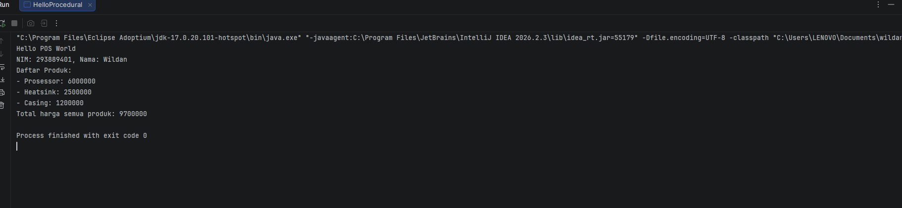
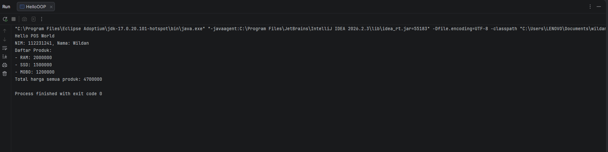
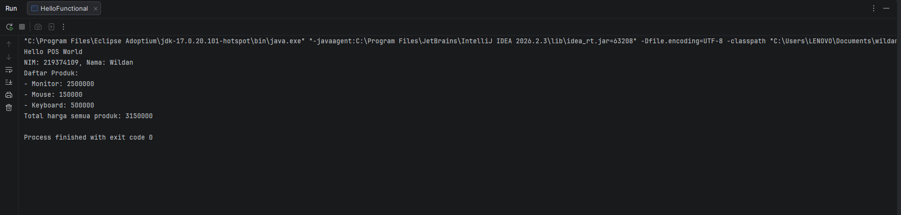

# Laporan Praktikum Minggu 1 
Topik: [Pengenalan Paradigma dan Setup Proyek]

## Identitas
- Nama  : [Ahmad Wildan Asrovi]
- NIM   : [250202927]
- Kelas : [3IKRB]

---

## Tujuan
- Mahasiswa mampu mendefinisikan paradigma prosedural, OOP, dan fungsional.
- Mahasiswa mampu membandingkan kelebihan dan keterbatasan tiap paradigma.
- Mahasiswa mampu memberikan contoh program sederhana untuk masing-masing paradigma.
- Mahasiswa aktif dalam diskusi kelas (bertanya, menjawab, memberi opini).

---

## Dasar Teori
Paradigma pemrograman adalah cara pandang dalam menyusun program:
1. Prosedural: program dibangun sebagai rangkaian perintah (fungsi/prosedur).
2. OOP (Object-Oriented Programming): program dibangun dari objek yang memiliki data (atribut) dan perilaku (method).  
3. Fungsional: program dipandang sebagai pemetaan fungsi matematika, lebih menekankan ekspresi dan transformasi data.

---

## Langkah Praktikum

1. **Setup project**
- Menginstal JDK, IntelliJ IDEA, Git, PostgreSQL, dan JavaFX di Perangkat yang digunakan
- clone Git dari mhbahara/oop-202501
- Menguji setup dengan dengan membuat dan menjalankan program Java sederhana
2. **File/kode yang dibuat.**
- Melakukan uji coba dengan kode 
```java public class HelloWorld {
  public static void main(String[] args) {
  System.out.println("Hello Agri-POS!");
     }
  } 
```

---

## Kode Program 
Kode class HelloProcedural
```java
String nim = "293889401";
String nama = "Wildan";
String[] produk = {"Prosessor", "Heatsink", "Casing"};
int[] harga = {6000000, 2500000, 1200000};
int total = 0;
```
kode class HelloOOP
```java
String nim = "112231241";
String namaMhs = "Wildan";
Produk[] daftar = {
        new Produk("RAM", 2000000),
        new Produk("SSD", 1500000),
        new Produk("MOBO", 1200000)
};
int total = 0;
```
Kode class HelloFunctional
```java
String nim = "219374109";
String nama = "Wildan";
List<String> produk = Arrays.asList("Monitor", "Mouse", "Keyboard");
List<Integer> harga = Arrays.asList(2500000, 150000, 500000);
```

---

## Hasil Eksekusi
(Sertakan screenshot hasil eksekusi program.  



)
---

## Analisis
## Analisis

### 1. Analisis Cara Kerja Program

Ketiga program dibuat menggunakan bahasa pemrograman Java dengan tujuan menampilkan informasi mahasiswa dan daftar produk beserta total harga seluruh produk. Meskipun menghasilkan keluaran yang serupa, ketiganya menggunakan pendekatan pemrograman yang berbeda.

Pada paradigma prosedural, program dijalankan melalui urutan instruksi di dalam method `main()`. Data produk dan harga disimpan dalam array, kemudian diproses menggunakan perulangan untuk menampilkan daftar produk sekaligus menghitung total harga.

Pada paradigma Object-Oriented Programming (OOP), data produk direpresentasikan menggunakan objek yang dibuat dari class `Produk`. Setiap objek memiliki atribut nama dan harga. Objek-objek tersebut kemudian disimpan dalam array dan diproses untuk menampilkan informasi serta menghitung total harga. Pendekatan ini membuat data dan representasi produk menjadi lebih terstruktur.

Pada paradigma fungsional, program memanfaatkan fitur Java seperti lambda expression dan Stream API. Daftar produk ditampilkan menggunakan `forEach()`, sedangkan total harga dihitung menggunakan `stream()` dan `sum()`. Pendekatan ini memungkinkan pemrosesan data dilakukan dengan kode yang lebih ringkas.

### 2. Perbandingan Ketiga Paradigma

Paradigma prosedural lebih mudah dipahami untuk program sederhana karena alur instruksinya jelas dan berurutan. Namun, ketika program semakin besar, pengelolaan data dan penambahan fitur dapat menjadi lebih sulit jika struktur program tidak dirancang dengan baik.

Paradigma OOP memisahkan data produk ke dalam objek sehingga program lebih mudah dikembangkan ketika terdapat penambahan atribut atau perilaku. Pendekatan ini sesuai untuk aplikasi yang memiliki banyak entitas, seperti produk, transaksi, dan pembayaran pada sistem POS (Point of Sale). Kekurangannya adalah memerlukan pemahaman mengenai class, object, dan hubungan antarobjek.

Paradigma fungsional memanfaatkan fungsi dan operasi untuk memproses data. Penggunaan Stream API dapat membuat proses pengolahan koleksi menjadi lebih ringkas. Namun, penggunaan lambda dan Stream API mungkin memerlukan pemahaman tambahan bagi pemula.

### 3. Kendala dan Cara Mengatasinya

Di minggu ini saya belum mendapatkan kendala, semuanya berjallan dengan lancar.

---

## Kesimpulan
## Kesimpulan

Berdasarkan praktikum yang telah dilakukan, dapat disimpulkan bahwa bahasa pemrograman Java dapat digunakan untuk menerapkan paradigma prosedural, Object-Oriented Programming (OOP), dan fungsional. Ketiga paradigma tersebut memiliki pendekatan yang berbeda dalam menyusun dan menjalankan program, meskipun dapat menghasilkan keluaran yang serupa.

Paradigma prosedural mengutamakan urutan instruksi, paradigma OOP mengorganisasikan data dan perilaku ke dalam objek, sedangkan paradigma fungsional memanfaatkan fungsi dan operasi untuk mengolah data. Setiap paradigma memiliki kelebihan dan kekurangan sesuai dengan kebutuhan program.

Melalui praktikum ini, Saya dapat memahami perbedaan dasar ketiga paradigma serta pentingnya memilih pendekatan pemrograman yang sesuai. Paradigma OOP menjadi salah satu pendekatan yang sesuai untuk aplikasi yang lebih kompleks, seperti Point of Sale (POS), karena struktur program dapat dibagi menjadi objek-objek yang merepresentasikan komponen sistem.

---

## Quiz
1. Tidak, OOP tidak selalu lebih baik dari prosedural. Ketika membuat sistem yang simple dan ringkas, maka prosedural lebih baik dari OOP, namun ketika membuat sistem yang membutuhkan kompleksitas yang lebih tinggi maka OOP jauh lebih baik dari Prosedural.


2. Ketika membutuhkan sistem yang stabil dan minim dari BUG 


3. - Prosedural: Program disusun berdasarkan urutan instruksi dan fungsi. Paradigma ini mudah dipahami untuk program sederhana, tetapi ketika aplikasi semakin besar, perubahan kode dapat memengaruhi bagian lain sehingga pemeliharaan menjadi lebih sulit.
   - OOP (Object-Oriented Programming): Program disusun menggunakan class dan objek yang menggabungkan data serta perilaku. Pemisahan komponen membuat kode lebih terstruktur, mudah diperbaiki, dan lebih mudah dikembangkan dengan menambahkan fitur atau objek baru.
   - Fungsional: Program memanfaatkan fungsi untuk mengolah data, idealnya dengan menghindari perubahan data (immutability) dan efek samping (side effects). Pendekatan ini dapat mempermudah pengujian dan mengurangi kesalahan, meskipun membutuhkan pemahaman tambahan jika menggunakan konsep fungsional yang lebih kompleks.
   - Kesimpulannya, ketiga paradigma dapat digunakan untuk membangun aplikasi yang mudah dipelihara dan dikembangkan. Namun, OOP cocok untuk aplikasi besar yang memiliki banyak komponen dan hubungan antarobjek, sedangkan paradigma prosedural cocok untuk program sederhana dan paradigma fungsional efektif untuk pengolahan data yang terstruktur. Hasil akhirnya tetap bergantung pada desain dan kualitas kode program.


4. Dikarenakan aplikasi POS memiliki kompleksitas yang tinggi, kalo menggunakan Prosedural, ketika ada data yang mau dirubah atau berubah maka kita harus mengubah atau mengecek satu per satu dari awal, sedangkan jika menggunakan OOP hanya perlu melihat dari claas mana yang dirubah.


5. Paradigma fungsional dapat mengurangi kode berulang (boilerplate code) dengan memanfaatkan fungsi, lambda expression, dan operasi seperti Stream API untuk memproses data secara ringkas. Misalnya, penggunaan forEach() dapat menggantikan perulangan manual untuk menampilkan setiap elemen, sedangkan map() dan filter() dapat digunakan untuk mengubah dan menyaring data tanpa menulis banyak instruksi berulang. Dengan demikian, kode menjadi lebih singkat, mudah dibaca, dan lebih mudah dipelihara.